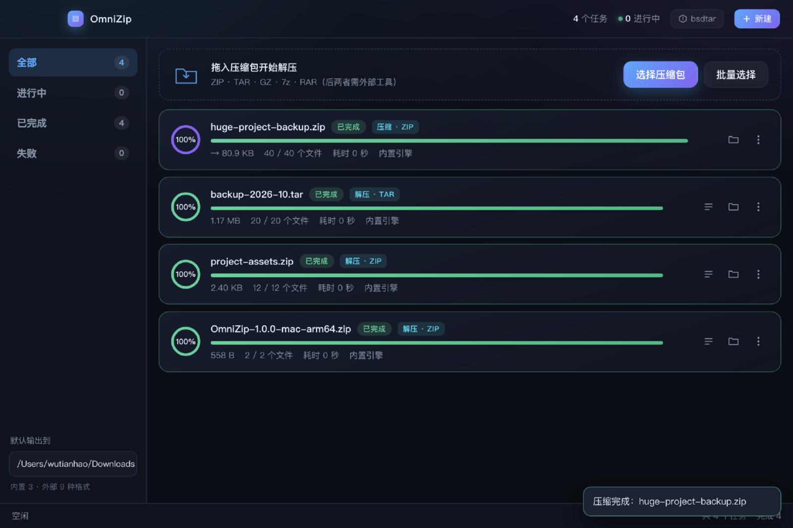

# OmniZip 📦

一个跨平台（macOS / Windows / Linux）的全能解压缩工具。
**ZIP / TAR / GZIP 由内置引擎处理，零运行时依赖**；7z / RAR / BZ2 / XZ / ISO / WIM 通过可选的外部 7-Zip 扩展。



## 功能

- ✅ **内置引擎**：ZIP（STORE/DEFLATE + ZIP64）、TAR（ustar/GNU LongLink/PAX）、GZIP —— 不装任何东西就能用
- ✅ **拖入即解压**：拖压缩包到窗口，或一次拖入多个
- ✅ **新建压缩包**：ZIP / TAR / TAR.GZ / GZ（装了 7-Zip 还能出 7z），可选压缩级别
- ✅ **内容预览**：解压前先看包里有什么（文件名、大小、加密标记、时间）
- ✅ **多任务队列**：最多 3 个任务并行，其余自动排队
- ✅ **暂停 / 继续 / 重跑**，进度环 + 速度 + 条目数实时显示
- ✅ **路径穿越防护**：恶意包里的 `../../etc/passwd` 会被限制在目标目录内
- ✅ **中文文件名**：UTF-8 与 GBK 兼容处理，CJK / 西里尔文件名往返无损
- ✅ **Unix 权限与时间戳还原**（macOS / Linux）
- ✅ **符号链接与硬链接**（TAR）：保留链接本身，不跟随（避免意外复制目标内容）
- ✅ **外部工具自动探测**：7-Zip / unrar / bsdtar，检测到即自动启用更强能力
- ✅ **任务持久化**：退出后保存，下次启动恢复
- ✅ **跨平台集成**：macOS 隐藏标题栏红绿灯、Windows/Linux 原生标题栏、访达/资源管理器/文件管理器定位
- ✅ **命令行打开**：`omnizip a.zip`，或双击压缩包（单实例，重复打开会复用窗口）

## 开发运行

```bash
npm install
npm start
```

> 需要 **Node.js ≥ 22**（UI 测试脚本用了内置 WebSocket）。
> 运行时跑在 Electron 内置 Node 上（Electron 33 → Node 20）。
> 国内网络（npm / Electron 二进制）走 npmmirror 镜像，`.npmrc` 里已配好。

### 可选：安装外部工具（扩展格式支持）

内置引擎覆盖 ZIP / TAR / GZIP。要解开 7z、RAR、BZ2、XZ、ISO、WIM 或加密包，需要装一个外部程序：

| 平台 | 命令 |
|---|---|
| macOS | `brew install sevenzip unrar` |
| Windows | 到 [7-zip.org](https://7-zip.org) 下载安装（或 `winget install 7zip.7zip`） |
| Linux | `sudo apt install 7zip unrar-free`（Debian/Ubuntu）或 `sudo dnf install p7zip p7zip-plugins`（Fedora/RHEL） |

装完点界面右上角的工具按钮 → 「重新检测」即可，无需重启。

## 测试

测试脚本不用测试框架，直接 `node scripts/xxx.mjs` 运行。

| 脚本 | 覆盖内容 | 项数 |
|---|---|---|
| `smoke-test.mjs` | 路径安全 / ZIP 读写 / TAR 读写 / GZIP / 格式探测 / 流式解压 | 32 |
| `engine-test.mjs` | 任务引擎：解压 / 压缩 / 列表 / 穿越防护 / 队列 / 暂停 / 持久化 / 删除 | 41 |
| `format-test.mjs` | 格式注册表 / 复合扩展名 / 边界情况 / **与系统 bsdtar 双向互操作** / 坏包容错 | 48 |
| `external-tool-test.mjs` | 外部工具适配：参数拼接 / 进度解析 / 退出码语义 / 列表解析 | 42 |
| `ui-test.mjs` | UI 自动化：首屏 / 任务渲染 / 弹窗 / 筛选 / 拖放区（需调试端口） | 41 |
| `run-all.mjs` | 依次跑全部（自动拉起应用跑 UI 测试） | 204 |

工具脚本（不参与回归）：

| 脚本 | 用途 |
|---|---|
| `gen-icon.mjs` | 生成 `build/icon.png` 主图标（纯 Node 绘制，三平台可跑） |
| `gen-icon-ico.mjs` | 从主图标派生 Windows 多尺寸 `build/icon.ico` |
| `optimize-png.mjs` | PNG 体积优化（缩放 + 去 alpha + 自适应行过滤），用于文档截图 |

改引擎代码后至少跑：

```bash
node scripts/smoke-test.mjs && node scripts/engine-test.mjs && node scripts/format-test.mjs
```

跑全部（含 UI）：

```bash
node scripts/run-all.mjs
# 或只跑非 UI 部分
node scripts/run-all.mjs --skip-ui
```

手动跑 UI 测试（需要先启动应用）：

```bash
./node_modules/.bin/electron . --remote-debugging-port=9333 --user-data-dir=/tmp/omnizip-ui-ud &
node scripts/ui-test.mjs 9333
```

## 打包成桌面应用

各平台分别打包（Electron 原生模块不能交叉编译）：

```bash
npm run dist        # macOS：本机架构的 .dmg
npm run dist:win    # Windows：NSIS 安装包
npm run dist:linux  # Linux：AppImage + deb + rpm
```

> **为什么不能一个平台打三个包？**
> Electron 的二进制与原生模块是按平台和 CPU 架构编译的。想一次产出全部安装包，
> 用仓库自带的 GitHub Actions 工作流（`.github/workflows/build.yml`），
> 手动触发或推送 `v*` tag 即可。

### 发布矩阵

| 平台 | 架构 | 产物 | 适用设备 |
|---|---|---|---|
| macOS | x64 | `.dmg` | Intel 芯片 Mac |
| macOS | arm64 | `.dmg` | Apple M 系列 |
| Windows | x64 | NSIS `.exe` | 大多数 Windows 10/11 |
| Windows | arm64 | NSIS `.exe` | 骁龙等 ARM 设备 |
| Linux | x64 | `.AppImage` / `.deb` / `.rpm` | 各发行版 |

> 产物均未签名：macOS 首次运行需 `xattr -cr /Applications/OmniZip.app`，
> Windows 会触发 SmartScreen（点「更多信息 → 仍要运行」）。

## 项目结构

```
src/
├── main/
│   ├── main.js                  # Electron 主进程：窗口、IPC、系统集成
│   ├── engines/
│   │   ├── archive-engine.js    # 任务引擎：队列 / 进度 / 暂停 / 持久化
│   │   ├── zip-engine.js        # ZIP 读写（ZIP64 / DEFLATE / Unix 权限）
│   │   ├── tar-engine.js        # TAR 读写（ustar / GNU / PAX）
│   │   └── stream-engine.js     # GZIP（单文件流）
│   └── lib/
│       ├── format-registry.js   # 格式注册表（签名 + 扩展名匹配）
│       ├── register-formats.js  # 显式注册全部格式
│       ├── external-tool.js     # 外部 7-Zip / unrar / bsdtar 适配
│       ├── paths.js             # 路径净化、穿越防护、重名分配
│       └── crc32.js             # CRC-32（zlib 优先，纯 JS 兜底）
├── preload/
│   └── preload.cjs              # contextBridge 安全桥接（唯一 .cjs）
└── renderer/
    ├── index.html               # 界面结构 + 弹窗模板
    ├── styles.css               # 深色主题（CSS 变量在 :root）
    ├── platform.js              # 平台标记（供 CSS / 文案区分）
    └── renderer.js              # 界面逻辑（原生 DOM，无框架）
```

## 数据存放位置

用户数据目录（`app.getPath('userData')`）：

| 平台 | 路径 |
|---|---|
| macOS | `~/Library/Application Support/OmniZip/` |
| Windows | `%APPDATA%\OmniZip\` |
| Linux | `~/.config/OmniZip/` |

文件：
- `tasks.json` — 任务列表（含每个任务的进度快照）
- `settings.json` — 默认输出目录

## 与 7-Zip 的关系

本项目的**格式解析思路**参考了 7-Zip 源码（`DOC/7zFormat.txt` 的容器规范、
handler 注册与签名匹配的分层设计），但代码是独立实现的，没有使用 7-Zip 的任何源码。

与 7-Zip 的定位差异：

| | 7-Zip | OmniZip |
|---|---|---|
| 实现语言 | C/C++ | JavaScript |
| 体积 | ~5 MB 二进制 | ~90 MB（Electron 运行时） |
| 格式覆盖 | 60+ | 内置 3 大类 + 外部 9 种 |
| 压缩算法 | 自己实现 LZMA/LZMA2/PPMd | 复用 Node zlib 的 DEFLATE |
| 优势 | 极致压缩率、极致性能 | 跨平台一致的现代 UI、零配置 |

> 需要极致压缩率时，装个 7-Zip，OmniZip 会自动调用它。

## 说明

- 仅供学习与个人合法用途。
